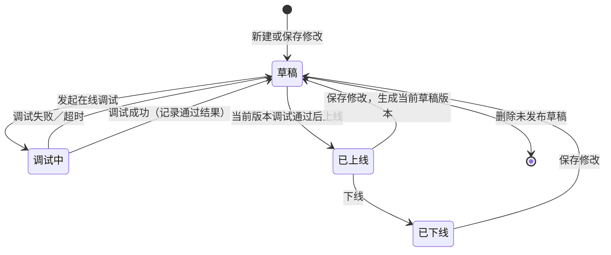
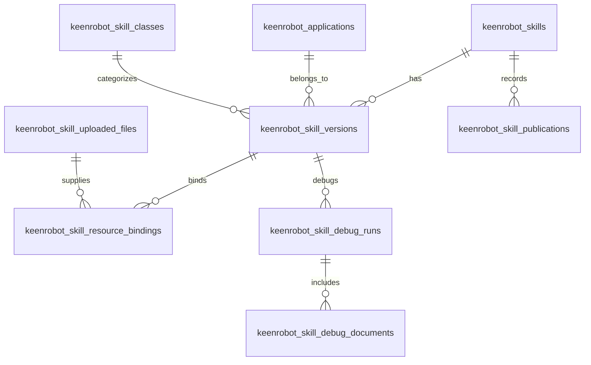

# 开发者中心后端与共享数据库设计（前期方案）

> 状态：待评审，尚未创建迁移或修改业务代码  
> 范围：开发者中心除“沙箱实际生成与结果内容”外的全部后端能力。  
> 依据：MVP 定稿、2026-10-16 调整说明、最新高保真原型，以及当前已有 Skill／知识库后端能力。

## 1. 边界与目标

开发者中心由本服务负责：本人技能列表、草稿创建和修改、资源上传与挂载、Skill 包构建、上线／下线、版本记录、权限校验，以及调试任务的创建与状态展示。

同事负责沙箱内部的用例生成和结果文档内容。本服务不处理模型执行逻辑，但会保存调试任务与结果文档索引，使用户关闭调试弹窗、刷新页面或重新登录后仍能看到运行状态和下载结果。

当前已有 `keenrobot_skills`、Skill 包构建和知识库能力。本方案以扩展和规范化现有数据为前提，不新建一套平行的“开发者技能”主表。

| 范围 | 负责方 | 说明 |
| --- | --- | --- |
| 技能草稿、编辑、删除、上线、下线 | 本服务 | 所有操作只允许创建者本人执行 |
| Skill 定义、版本、资源清单和 ZIP 构建 | 本服务 | 复用现有 Skill Package 服务 |
| 知识库检索和挂载校验 | 本服务 | 复用现有知识库与文档权限规则 |
| 调试任务创建、查询、运行状态保存 | 本服务 | 为前端提供稳定的状态查询入口 |
| 沙箱执行、用例生成、Excel 文档内容 | 同事服务 | 返回 `run_id`，并回写执行状态和结果位置 |
| 真实文件字节 | 对象存储 | 云数据库仅保存元数据、哈希和存储键，不保存大文件 BLOB |

## 2. 核心业务规则

- 平台采用个人权限：技能、草稿和私有资源仅创建者本人可编辑；公共知识库可被授权用户挂载。
- 一个技能名称在未删除的技能中唯一。前端可预校验，后端和数据库唯一约束必须再次校验。
- 新建、保存修改后的技能均为“草稿”；草稿可删除，删除操作由前端二次确认，后端只接收明确的删除请求。
- 已上线技能保存修改后，当前编辑版本变为“草稿”，必须基于当前版本重新调试成功后才能再次上线。
- 上线只允许当前版本存在一次成功的调试记录。下线后状态为“已下线”，不删除版本、包或操作记录。
- 页面展示状态仅保留：`草稿`、`调试中`、`已上线`、`已下线`。调试是否成功、失败或超时作为最近调试记录的结果展示，不额外增加页面主状态。
- 直接上传资源格式为 `.py/.js/.md/.xlsx/.docx/.png/.jpg/.jpeg`；单文件和当次总大小均不超过 50 MiB。调试文档格式为 `.pdf/.doc/.docx/.md/.txt/.xls/.xlsx/.json`，最多 10 个，单文件和总大小同样不超过 50 MiB。

## 3. 状态与版本流转

“调试成功”后主状态仍显示为草稿，避免引入原型没有的“调试通过”状态；系统以当前版本的最近成功调试记录作为上线凭证。

对于“已上线后修改”的数据安全策略：旧上线版本保留在版本历史中；当前技能状态切为草稿且对外不可用。若后续要求“编辑期间旧版本仍继续对外服务”，可增加 `published_version_id` 指针实现双版本并存，但不在本期擅自改变已确认的“修改后变草稿”规则。

## 4. 数据库总体关系

## 5. 表设计

### 5.1 保留并扩展 `keenrobot_skills`

现有表继续作为技能主实体，保留既有 `id`、`name`、`name_key`、`description`、`user_id`、`is_enabled`、软删除字段和时间字段。

新增或规范的字段如下：

| 字段 | 类型 | 说明 |
| --- | --- | --- |
| `current_version_id` | varchar(36)，可空 | 当前正在编辑或展示的版本 |
| `display_status` | varchar(16) | `DRAFT/DEBUGGING/ONLINE/OFFLINE`，映射页面四种状态 |
| `current_revision` | int | 乐观锁版本号，防止两次保存互相覆盖 |
| `last_debug_run_id` | varchar(64)，可空 | 最近一次调试任务 |
| `last_debug_passed_at` | datetime，可空 | 当前版本最近一次调试成功时间 |
| `published_at` | datetime，可空 | 最近一次上线时间 |
| `offline_at` | datetime，可空 | 最近一次下线时间 |

`is_enabled` 只表示当前技能是否允许对外使用，和 `display_status=ONLINE` 保持一致；不再让前端直接修改该字段。

### 5.2 `keenrobot_skill_versions`：技能版本快照

每次保存能形成 Skill 定义的内容时写入一个版本快照。Skill 包构建结果和调试必须绑定到具体版本，避免用户保存新内容后仍用旧包上线。

| 字段 | 类型 | 说明 |
| --- | --- | --- |
| `id` | varchar(36)，主键 | UUID |
| `skill_id` | varchar(36)，索引 | 关联 `keenrobot_skills.id` |
| `version` | varchar(32) | 如 `1.0.0`，同一技能内唯一 |
| `revision` | int | 保存修订号，用于乐观锁 |
| `skill_class_id` | varchar(36) | 所属技能类 |
| `application_id` | varchar(36)，可空 | 所属应用；全应用适用用业务值 `*` 表示 |
| `description` | varchar(1024) | 技能描述 |
| `instructions` | text | 执行指令／业务约束 |
| `resource_usage` | text，可空 | 有知识库或资源时必填 |
| `compatibility` | varchar(500)，可空 | 运行环境要求 |
| `skill_markdown` | longtext，可空 | 当前 Skill 定义文本 |
| `build_id` | varchar(64)，可空 | 现有构建服务返回的构建标识 |
| `package_storage_key` | varchar(512)，可空 | ZIP 在对象存储中的位置 |
| `manifest_hash` | char(64)，可空 | 包清单哈希，用于确认调试输入版本 |
| `created_by` | bigint | 创建人 |
| `created_at` / `updated_at` | datetime | 审计时间 |

约束与索引：`UNIQUE(skill_id, version)`；索引 `(skill_id, created_at)`、`(application_id)`。

### 5.3 `keenrobot_skill_uploaded_files`：直接上传资源元数据

该表只存放“非知识库”的资源文件。知识库文件继续使用现有知识库文档表，不能重复复制业务记录。

| 字段 | 类型 | 说明 |
| --- | --- | --- |
| `id` | varchar(36)，主键 | 文件标识 |
| `original_name` | varchar(255) | 用户原始文件名，仅作展示 |
| `extension` | varchar(16) | 已规范化的小写扩展名 |
| `mime_type` | varchar(128) | 服务端识别的 MIME 类型 |
| `byte_size` | bigint | 文件字节数 |
| `sha256` | char(64) | 完整性和去重依据 |
| `storage_key` | varchar(512) | 对象存储服务端生成的键 |
| `uploaded_by` | bigint | 上传人 |
| `state` | varchar(16) | `ACTIVE/DELETED` |
| `created_at` / `deleted_at` | datetime | 生命周期审计 |

索引：`(uploaded_by, state, created_at)`、`(sha256)`。服务端拒绝路径分隔符、空文件和不支持的扩展名，任何客户端传入的文件名都不得作为存储路径。

### 5.4 `keenrobot_skill_resource_bindings`：版本与资源绑定

把版本与知识库文档、知识库本身或直接上传文件建立不可变绑定，并记录使用分类和快照信息。

| 字段 | 类型 | 说明 |
| --- | --- | --- |
| `id` | varchar(36)，主键 | 绑定标识 |
| `skill_version_id` | varchar(36)，索引 | 所属技能版本 |
| `source_type` | varchar(32) | `KNOWLEDGE_BASE`、`KNOWLEDGE_DOCUMENT`、`UPLOADED_FILE` |
| `source_id` | varchar(36) | 对应资源 ID |
| `source_version` | varchar(64)，可空 | 知识库／文档的快照版本 |
| `file_id` | varchar(36)，可空 | 直接上传文件 ID |
| `display_name` | varchar(255) | 版本中展示名称 |
| `category` | varchar(16) | `reference/template/asset/script` |
| `usage` | text，可空 | 资源使用说明快照 |
| `content_hash` | char(64)，可空 | 资源内容哈希 |
| `sort_order` | int | 展示顺序 |
| `created_at` | datetime | 创建时间 |

索引：`(skill_version_id, sort_order)`、`(source_type, source_id)`。构建包时从绑定记录复制资源快照；知识库后续更新不应改写已经生成的 Skill 版本。

### 5.5 `keenrobot_skill_debug_runs`：调试任务与结果索引

这是与同事沙箱服务共享的关键表。任务由本服务创建；沙箱只更新执行状态和结果文档信息，双方不得各自创建不同的调试记录。

| 字段 | 类型 | 说明 |
| --- | --- | --- |
| `id` | varchar(36)，主键 | 平台内部调试记录 ID |
| `run_id` | varchar(128)，唯一 | 同事沙箱返回的运行 ID |
| `skill_id` | varchar(36)，索引 | 对应技能 |
| `skill_version_id` | varchar(36)，索引 | 调试所用版本，必须固定 |
| `build_id` | varchar(64) | 调试所用构建 |
| `status` | varchar(16) | `QUEUED/RUNNING/SUCCEEDED/FAILED/TIMEOUT` |
| `conversation_input` | text，可空 | 对话输入 |
| `request_document_count` | int | 调试需求文档数量 |
| `resource_manifest_hash` | char(64) | 当次挂载资源快照校验 |
| `result_storage_key` | varchar(512)，可空 | 结果 Excel 的对象存储位置 |
| `result_file_name` | varchar(255)，可空 | 下载文件名 |
| `result_byte_size` | bigint，可空 | 结果大小 |
| `error_code` / `error_message` | varchar(64) / text | 失败或超时信息 |
| `started_at` / `finished_at` | datetime，可空 | 执行时间 |
| `created_by` / `created_at` | bigint / datetime | 发起人与时间 |
| `updated_at` | datetime | 最后状态更新时间 |

约束与索引：`UNIQUE(run_id)`；索引 `(skill_version_id, status, created_at)`、`(skill_id, created_at)`。`run_id` 支持幂等回调，关闭调试弹窗不会取消运行。

### 5.6 `keenrobot_skill_debug_documents`：调试输入文档

调试时上传的需求文档和技能资源分开管理，文档只归属于一次调试任务。

| 字段 | 类型 | 说明 |
| --- | --- | --- |
| `id` | varchar(36)，主键 | 文档 ID |
| `debug_run_id` | varchar(36)，索引 | 所属调试任务 |
| `original_name` | varchar(255) | 原始文件名 |
| `extension` / `mime_type` | varchar | 文件类型 |
| `byte_size` / `sha256` | bigint / char(64) | 大小与完整性 |
| `storage_key` | varchar(512) | 对象存储位置 |
| `created_at` | datetime | 上传时间 |

约束：每个 `debug_run_id` 最多 10 条；由服务端在写入前计算总大小不超过 50 MiB。

### 5.7 `keenrobot_skill_publications`：上线／下线操作历史

| 字段 | 类型 | 说明 |
| --- | --- | --- |
| `id` | varchar(36)，主键 | 记录 ID |
| `skill_id` | varchar(36)，索引 | 技能 |
| `skill_version_id` | varchar(36) | 操作对应版本 |
| `action` | varchar(16) | `ONLINE/OFFLINE` |
| `operator_id` | bigint | 操作人 |
| `reason` | varchar(500)，可空 | 下线原因，可预留 |
| `created_at` | datetime | 操作时间 |

### 5.8 应用与技能类目录

应用和技能类应由服务端提供，前端只能搜索选择，不能手填未登记项。

| 表 | 核心字段 | 说明 |
| --- | --- | --- |
| `keenrobot_applications` | `id`、`code`、`name`、`is_active`、`source`、`synced_at` | 由应用目录同步；`*` 是“全应用适用”的业务值，不新建一条伪应用记录 |
| `keenrobot_skill_classes` | `id`、`code`、`name`、`description`、`is_active`、`sort_order` | 预置平台六类技能，便于后续配置和停用 |

## 6. 接口设计

以下路由以 `/developer` 为页面专用入口。现有 `/skills`、`/skills/form/builds` 和知识库接口可作为内部复用能力，逐步迁移，不要求一次删除旧接口。

| 方法与路径 | 用途 | 说明 |
| --- | --- | --- |
| `GET /developer/skills` | 我的技能列表 | 支持 `keyword/status/page/page_size`；仅返回当前用户的技能 |
| `POST /developer/skills` | 新建草稿 | multipart，包含表单 JSON 和资源文件；后端创建主实体、初版和绑定 |
| `GET /developer/skills/{skill_id}` | 技能详情 | 返回当前版本、资源、最近调试、可用操作 |
| `PUT /developer/skills/{skill_id}` | 保存草稿／保存修改 | 传 `expected_revision`；已上线保存后自动切为草稿 |
| `DELETE /developer/skills/{skill_id}/draft` | 删除草稿 | 只允许创建人删除草稿；后端软删除并清理未引用文件 |
| `POST /developer/skills/{skill_id}/build` | 构建 Skill 包 | 复用现有构建服务，返回 `build_id` 和版本清单 |
| `GET /developer/skills/{skill_id}/versions` | 版本历史 | 提供查看与追溯，不在本期增加回滚页面 |
| `POST /developer/skills/{skill_id}/publish` | 上线 | 校验当前版本和构建存在成功调试记录 |
| `POST /developer/skills/{skill_id}/offline` | 下线 | 设置不可用并写操作历史 |
| `GET /developer/skill-classes` | 技能类目录 | 返回可选技能类 |
| `GET /developer/applications` | 应用目录 | 支持关键词搜索；可返回“全应用适用”选项 |
| `GET /developer/knowledge-bases` | 挂载知识库候选 | 复用现有名称模糊搜索和权限过滤 |
| `POST /developer/skills/{skill_id}/debug-runs` | 发起调试 | 创建运行记录、保存输入文档、调用同事的生成接口 |
| `GET /developer/debug-runs/{run_id}` | 查询调试进度 | 弹窗关闭、刷新或重新打开时轮询该接口 |
| `GET /developer/debug-runs/{run_id}/document` | 下载调试结果 | 本服务鉴权后代理或签发对象存储下载地址 |

保存、构建、上线、下线均从登录 Token 获取用户身份；前端不可传入 `user_id`、状态、版本号或文件存储路径作为可信字段。

## 7. 与沙箱服务的联调契约

建议采用“本服务维护调试主记录，沙箱通过回调更新结果”的方式。即使两个服务使用同一个云数据库，也避免同事服务随意修改技能、版本和资源表。

1. 本服务先创建 `debug_runs` 记录，状态 `QUEUED`，再调用同事的 `POST /realtime-test-case-gen/generate`。
2. 调用中提交：Skill Markdown、对话输入、需求文档、挂载资源，以及平台生成的关联标识 `run_id`／`skill_version_id`。
3. 沙箱收到后把任务置为 `RUNNING`；完成时调用内部回调：`POST /internal/debug-runs/{run_id}/callback`，更新 `SUCCEEDED/FAILED/TIMEOUT`、结果文件元数据和错误信息。
4. 前端始终查询本服务的 `GET /developer/debug-runs/{run_id}`，不直接依赖沙箱短连接。关闭弹窗只停止轮询，不取消任务。
5. 若同事暂时只能提供“按 run_id 下载文档”的接口，本服务仍保存 `run_id` 和状态；在用户下载时鉴权后调用同事的文档接口并将结果写入对象存储索引。

回调要具备共享密钥或服务间认证、`run_id` 幂等、重复回调安全处理和状态单向校验。任务终态 `SUCCEEDED/FAILED/TIMEOUT` 不应被旧的 `RUNNING` 回调覆盖。

## 8. 云数据库与文件存储建议

- 云端使用 MySQL 8、`utf8mb4`、`Asia/Shanghai` 时区；沿用当前 Tortoise ORM 与 Aerich。
- 大文件、Skill ZIP、调试输入和结果文档放对象存储；数据库只保存 `storage_key`、原名、大小、哈希、创建者和时间。
- 服务账户分离：开发者中心服务可读写本方案表；沙箱服务优先只通过回调 API 更新调试结果。如必须直连数据库，仅允许更新 `keenrobot_skill_debug_runs` 的状态和结果字段。
- 所有保存操作使用事务：主技能、版本和资源绑定要么同时成功，要么同时回滚。调用外部沙箱前先提交 `QUEUED` 记录，防止页面关闭后丢失任务。
- 保存请求带 `expected_revision`，出现并发编辑时返回冲突，避免后一次保存覆盖前一次。
- 首次连接云数据库前先对现有 `keenrobot_skills` 数据做名称、版本和状态审计；创建 Aerich 迁移后在测试库和预发布库验证，再安排生产迁移与备份，不在应用启动时无审查地执行结构变更。

## 9. 分阶段实施计划

| 阶段 | 本服务实现内容 | 可验收结果 |
| --- | --- | --- |
| 0：数据准备 | 确认现有表、创建迁移、预置技能类、接入应用目录 | 云测试库可创建并查询目录 |
| 1：草稿闭环 | 列表、新建、编辑、名称唯一、资源上传、草稿删除、个人权限 | 页面不再依赖前端写死数据完成草稿操作 |
| 2：版本与构建 | 版本快照、资源绑定、Skill 包构建和版本查询 | 同一版本的 Markdown、资源和 ZIP 可追溯 |
| 3：调试任务联调 | 创建／查询调试任务、关闭弹窗后续跑、状态回写、结果下载 | 刷新页面仍能看到真实运行状态和结果 |
| 4：上线治理 | 调试成功校验、上线／下线、修改后转草稿、操作历史 | 只有当前版本成功调试后才能上线 |
| 5：上线前验证 | 权限、并发、文件限制、回调幂等、迁移回滚与备份演练 | 可连接云数据库进行联调 |

## 10. 评审时需与同事确认的项

1. 调试服务是提供状态回调，还是只提供按 `run_id` 查询／下载；优先使用回调。
2. 结果 Excel 由谁上传对象存储、如何返回文件名、大小和哈希。
3. 同事服务接收的资源字段名称与顺序：当前技能资源、挂载知识库资源和本次调试输入文档必须明确区分。
4. `run_id` 由平台预生成还是由沙箱生成后返回；无论哪种方式，最终必须全局唯一并能幂等更新。
5. 已上线技能修改后是否需要保持旧版本继续对外服务。本期按已确认规则：保存修改后当前技能变为草稿并停止对外可用。

## 11. 本期不做

- 不实现沙箱模型、测试用例生成算法或结果 Excel 的业务内容。
- 不实现审批流、团队／敏捷小队权限、Docker 镜像管理。
- 不把资源文件或结果 Excel 写入数据库 BLOB。
- 不新增原型中没有的“调试通过”页面主状态或下载 Skill 包按钮。
