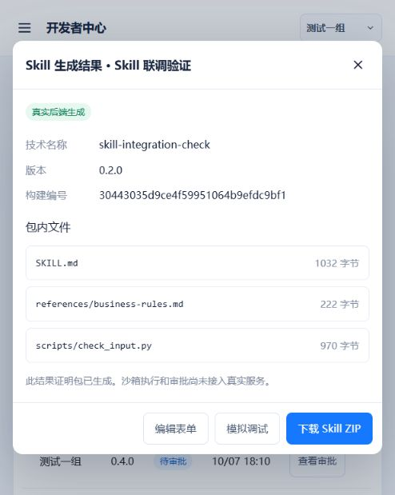

# Skill 表单生成：前后端联调记录

验证日期：2026-10-12。后端与前端均在 `znfwdd` 分支，代码尚未提交或推送。

## 本次接入范围

React 表单 → 真实用户登录 → 创建后端技能记录 → 生成标准 Skill 包 → 查询 → ZIP 下载。

参考资料和脚本分别提交 `reference_files`、`script_files`，并通过 `source` JSON 字符串传递对应的 `reference_uploads`、`script_uploads` 使用说明。后端固定分类到 `references/`、`scripts/`。无附件时使用普通 JSON 构建接口。生成时不执行上传脚本。

正式项目 Skill 路由复用现有代码。新增 `examples/skill_integration_server.py` 仅作为本地联调入口，复用现有登录、认证和 Skill API，通过持久化 SQLite 验证完整请求链路，不依赖未提供的团队 MySQL、Redis 或模型配置。没有验证正式 MySQL 部署或对话台加载执行。

## 启动与使用

在后端仓库根目录：

```powershell
.\.venv\Scripts\python.exe -m examples.skill_integration_server
```

在前端 `agent-template-frontend` 仓库根目录：

```powershell
npm run dev
```

当前页面地址为 `http://localhost:5174`，后端监听 `127.0.0.1:8519`。前端开发、预览和静态服务代理 `/skills`、`/base`、`/health`。本地测试账号 `skill-dev`，密码 `SkillLocal2026!`。账号只在此隔离入口自动创建；正式服务不会自动创建。

`GET /health` 返回 `mode=local-skill-integration`、`database=sqlite`、`model_execution=false`。数据与密钥位于已被 Git 忽略的 `output/skill-integration/`；联调服务只绑定本机地址。

## 已验证场景

| 场景 | 结果 |
|---|---|
| 错误密码登录 | 显示真实后端的用户名或密码错误 |
| 正确账号登录 | 取得现有认证接口的 token，后续请求携带 token 请求头 |
| 必填表单为空 | 在实现名称、技术名称、实现说明、执行指令旁提示错误 |
| 无附件生成 | 真实生成仅含 `SKILL.md` 的 Skill 包 |
| 上传资料和脚本但漏填使用说明 | 真实后端拒绝生成，错误映射到两个文件的使用说明字段 |
| 补齐使用说明后生成 | 得到 `SKILL.md`、`references/business-rules.md`、`scripts/check_input.py` |
| 查询与下载 | 真实构建查询及鉴权 ZIP 下载通过 |
| 下载内容校验 | 两个附件字节与原文件完全一致；YAML 名称、版本、环境要求和正文资源链接正确 |
| 刷新页面后查看 Skill 包 | 登录会话和本地构建编号恢复，重新向后端查询成功 |

浏览器生成样例：`skill-integration-check`，版本 `0.2.0`，构建编号 `30443035d9ce4f59951064b9efdc9bf1`。浏览器下载文件为用户下载目录的 `skill-integration-check.zip`。

回归检查：后端 `python -m pytest tests -q` 为 **103 passed**，另有既有依赖弃用警告；测试日志目录已补充初始化。前端 `npm run build`（TypeScript、CSS 与 Vite）通过；静态服务器 `node --check server.js` 和两仓库 `git diff --check` 通过。



## 当前边界

- 技能类目录、原挂载选择器、输入输出示例仍为 mock。示例资源 ID 不会被当成真实数据库 ID 发送；生成时需取消示例挂载，使用实际文件上传。
- 沙箱运行与审批仍为模拟，并在界面标注；Skill 已生成不等于模型或脚本已执行成功。
- 草稿和列表暂存在浏览器本地；文件仅保留在当次编辑中，关闭窗口后重新选择。构建包及其清单真实存储在后端。
- 创建者由后端认证用户提供。当前团队、系统来自现有表单，尚未接入正式团队权限管理。
- 正式用户体系、服务端列表、MySQL 部署、知识库检索和对话台目录加载需要后续接入。
